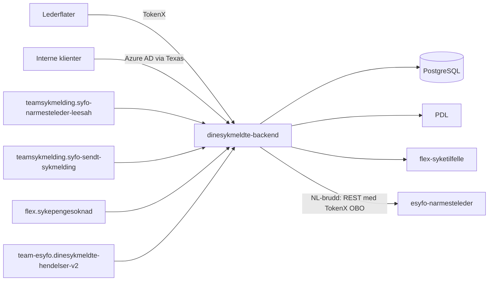

# Backend for nærmeste leders oversikt over sykmeldte (dinesykmeldte)

Dette er backenden for nærmeste leders oversikt over sykmeldte. Tjenesten samler data om sykmeldinger, søknader, hendelser og virksomheter, og gjør dem tilgjengelige for lederflater i team-esyfo.

Repoet brukes av klienter og tjenester som `dinesykmeldte`, `esyfo-narmesteleder`, `oppfolgingsplan-frontend`, `dialogmote-frontend` og `syfo-oppfolgingsplan-backend`, slik de er satt opp i NAIS-manifestene.

## API

OpenAPI-kontrakten ligger i [`api/oas3/dinesykmeldte-backend-api.yaml`](api/oas3/dinesykmeldte-backend-api.yaml). I dev vises kontrakten i Swagger UI på `/api/v1/docs/`. Kontrakten dekker ikke nødvendigvis alle Ktor-ruter i applikasjonen.

Kontrakten dokumenterer blant annet:

- `GET /api/minesykmeldte`
- `GET /api/sykmelding/{sykmeldingId}`
- `PUT /api/sykmelding/{sykmeldingId}/lest`
- `GET /api/soknad/{soknadId}`
- `PUT /api/soknad/{soknadId}/lest`
- `PUT /api/hendelse/{hendelseId}/lest`
- `GET /api/virksomheter`

Koden eksponerer også disse verifiserte endepunktene:

- `GET /api/v2/dinesykmeldte`
- `GET /api/v2/dinesykmeldte/{narmestelederId}`
- `POST /api/narmesteleder/{narmesteLederId}/avkreft`
- `PUT /api/hendelser/read`
- `POST /api/sykmelding/isActiveSykmelding`

## Kafka

Tjenesten konsumerer meldinger fra:

- `teamsykmelding.syfo-narmesteleder-leesah`
- `teamsykmelding.syfo-sendt-sykmelding`
- `flex.sykepengesoknad`
- `team-esyfo.dinesykmeldte-hendelser-v2`

Tjenesten produserer ikke Kafka-meldinger.

NL-brudd sendes med `DELETE /internal/api/v1/linemanager/{id}` til `esyfo-narmesteleder`. Lokale koblinger slettes først etter svar med status 202. Ved feil beholdes koblingen.

Kafka-topicet `dinesykmeldte-hendelser-v2` er definert i [`nais/topics/dinesykmeldte-hendelser-v2.yaml`](nais/topics/dinesykmeldte-hendelser-v2.yaml).

## Autentisering og tilgang

- De fleste API-ene ligger bak TokenX og krever nivå 4.
- REST-kall for NL-brudd bruker lederens TokenX-token til OBO-tokenutveksling via Texas. `ESYFO_NARMESTELEDER_URL` angir tjenestens adresse, og `ESYFO_NARMESTELEDER_AUDIENCE` har formatet `<cluster>:team-esyfo:esyfo-narmesteleder`.
- `POST /api/sykmelding/isActiveSykmelding` validerer Azure AD-token via Texas.
- Lederen leser sykmeldinger, søknader og hendelser på alle personens folkeregisteridenter fra PDL (`hentIdenterBolk`). Det gjelder bare når relasjonen er den eneste aktive for personen i virksomheten. Ellers, og når oppslaget feiler, gjelder bare identen på relasjonen.
- Fullstendige svar fra PDL `hentIdenterBolk` mellomlagres i en dedikert Valkey-instans i høyst fem minutter. Utløpstiden forlenges ikke ved lesing. Feil og fallback mellomlagres ikke; ved cachefeil brukes PDL (fail-open). Navn, tilgangsbeslutninger og nærmeste leder-relasjoner mellomlagres ikke.
- NAIS `accessPolicy` åpner for innkommende kall fra verifiserte klienter i manifestene, blant annet `dinesykmeldte`, `esyfo-narmesteleder`, `oppfolgingsplan-frontend`, `dialogmote-frontend` og `syfo-oppfolgingsplan-backend`.

## Utvikling

Bruk `mise tasks` for oppdatert oversikt over tilgjengelige oppgaver.

Start lokale avhengigheter, inkludert Valkey uten persistens, med `mise docker-up`,
og appen med `mise start` (`./gradlew run`). Lokal Valkey bruker `localhost:6379`
uten TLS eller innloggingsopplysninger. `VALKEY_LOCAL_HOST` kan overstyre verten;
`mise docker-run-local-image` setter den til `valkey` på Compose-nettverket.

I Nais brukes TLS med vertsnavnkontroll og de injiserte
`VALKEY_*_DINESYKMELDTE_BACKEND_CACHE`-variablene mot primærnoden.
Den dedikerte instansen `dinesykmeldte-backend-cache` må opprettes separat i hvert
miljø **før appen deployes**. Infrastrukturprovisjonering inngår ikke i appens deploy.
Valkey påvirker ikke readiness. Tilkoblings- og socket-timeout er 500 ms, og venting
på ledig forbindelse er 100 ms. Cacheoperasjoner har også en coroutine-frist;
innstillingene gir ikke en hard samlet svartidsgrense (blant annet DNS og blokkerende I/O).
Token- og PDL-oppslag beholder sitt separate budsjett på fem sekunder.

`dinesykmeldte_backend_pdl_cache_total{cache="identer",result="..."}`
teller `hit`, `miss` og `invalid` per forespurt ident (ugyldig verdi er et cachemiss),
og `read_error`/`write_error` per mislykket operasjon. Lesefeil teller ikke også
som `miss`, og hindrer cacheskriving i samme oppslag. Cachetreff inngår i
`identer_lookup_total`, slik at nevneren for fallback-varsling fortsatt dekker alle oppslag.

## Kontakt

Repoet vedlikeholdes av [navikt/team-esyfo](CODEOWNERS).

For Nav-ansatte: kontakt oss i [#esyfo på Slack](https://nav-it.slack.com/archives/C012X796B4L).
